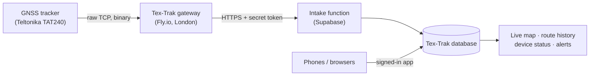

# Tex-Trak GNSS tracking: how we built it and fitted it into the platform

*CIRCAI LTD · Track · Trace · Prove*

## In one paragraph

Tex-Trak already tracked items by QR code and RFID. We added GNSS (satellite) tracking so the same platform can also answer **"where is the vehicle or asset right now, and where has it been?"** We did not build a separate product. The new module reuses the existing accounts, permissions, database and app, so it shipped as an extension of what was already there, not as a second system to run.

## The problem we solved

Customers move goods in vehicles and cages between sites. QR and RFID tell you what happened at a scan point, but not what happens in between. GNSS fills that gap. The technical difficulty is that tracker hardware speaks a compact binary protocol over raw TCP, which ordinary web back ends cannot receive.

## How it works

1. **Tracker** reports its position every 6 minutes (to preserve battery).
2. **Gateway** (a small service we wrote) accepts the tracker's TCP connection, checks the device is registered and active, decodes the binary data (Teltonika Codec 8 / 8 Extended), verifies its integrity check, and confirms receipt so the tracker does not resend.
3. **Intake function** stores the positions in the same database as everything else, ignoring duplicates.
4. **The app** shows live position, daily route history (distance, moving time, CSV export), and online / quiet / offline status.

Phones and browsers feed the same tables, so a driver's phone and a hardware tracker appear on one map.

## How it fitted into the existing stack

| Existing part | What we reused | What we added |
|---|---|---|
| Database (Supabase Postgres) | Same security model: each client sees only its own data | Position and tracker tables, 30-day retention job |
| Accounts and permissions | Super Admin → client admin → staff, per-feature switches | A "tracking" feature that can be switched on per client |
| App (web + Android) | Same screens, maps and navigation | Live map, route history, device status page |
| Server functions | Same hosting and deployment | One intake function |
| New infrastructure | None before this | One small gateway service (the only new thing to host) |

Effort and risk stayed low because the only genuinely new component is the gateway. Everything else is the platform we already operate.

## Design decisions that matter commercially

- **Only registered devices are accepted.** Unknown trackers are refused at the gateway and again at the server.
- **Multi-client by design.** A tracker belongs to one client and its positions can never appear in another client's account.
- **Storage stays cheap.** Full detail is kept for 30 days; older data is reduced to time and coordinates by a nightly job. This keeps costs predictable as devices grow.
- **Bad data is filtered.** Readings with no GPS fix and repeated readings are not stored or shown.
- **Hardware-agnostic path.** The gateway decodes a standard protocol. Supporting other Teltonika models is a configuration task; other brands need a new decoder, not a new platform.
- **Phone tracking at no hardware cost.** The Android app tracks in the background and stores positions offline when there is no signal, then sends them later.

## Where it stands, honestly

| Area | Status |
|---|---|
| Protocol decoding, acknowledgements, integrity check | **Tested** against a simulated tracker end to end |
| Database rules, duplicate handling, 30-day retention | **Tested** on the live database |
| Phone positions into the database | **Tested** |
| Gateway hosted and running | **Live** (a redeploy with the latest hardening is pending) |
| A real TAT240 reporting over the live gateway | **Not yet seen**: the next milestone, requiring the physical device to be configured and taken outdoors |
| Background tracking on a real Android phone | **Built, not yet device-tested** |
| Alerts such as low battery or leaving an area | Not built yet |

## Next steps

1. Configure and field-test a real TAT240 (about an hour, outdoors).
2. Redeploy the gateway with the latest hardening.
3. Add alerts (battery, no signal, entering or leaving a zone).
4. Pilot with the first client's vehicles, then measure data volume and cost per device.

## Contact

surya@circai.co.uk
