# Tex-Trak: Technical guide

How Tex-Trak is built and how it works, in plain words, with diagrams. The diagrams are written in Mermaid, so they draw themselves on GitHub and in most Markdown viewers.

For a non-technical tour of the features, read `PRODUCT_GUIDE.md`. For what has and has not been tested, read `FEATURE_PLAN.md`.

---

## 1. The idea in one picture

Tex-Trak records **where things are and what happened to them**. Things are identified in one of four ways (QR code, barcode, RFID tag, GPS tracker). Every identification becomes a small record in one shared database. Screens, alerts and reports are built from those records.

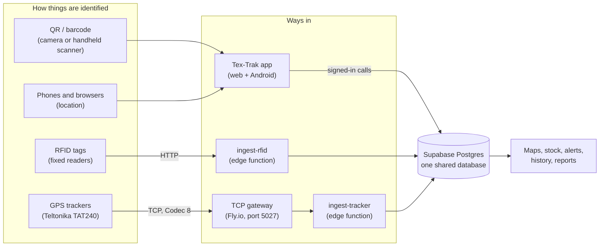

---

## 2. The building blocks

| Block | What it is | Why it exists |
|---|---|---|
| **App** (`app/`) | One React 19 + TypeScript + Vite + Tailwind v4 code base | The same screens run in a browser and inside the Android app |
| **Android shell** (`app/android`) | Capacitor wrapper, version 1.3 | Gives the app a camera, background location and offline storage on phones |
| **Database** | Supabase Postgres, with row-level security | Holds all data and enforces who may see or change it |
| **Edge functions** (`supabase/functions/`) | `admin-users`, `ingest-rfid`, `ingest-tracker` | Code that must run on the server: account admin and hardware intake |
| **Gateway** (`gateway/`) | Small Node service on Fly.io (London) | Trackers speak raw TCP, which edge functions cannot accept, so the gateway translates |
| **Scheduler** | `pg_cron` inside the database | Nightly clean-up of old tracker detail |

Why one code base for web and phone: a fix or feature is written once. Both versions call the same database functions, so data is always the same on both.

### Main libraries

React 19, Vite, TypeScript, Tailwind v4, zustand (state), Leaflet (maps), Capacitor (Android), idb-keyval (offline storage in the device), lucide (icons).

---

## 3. Architecture

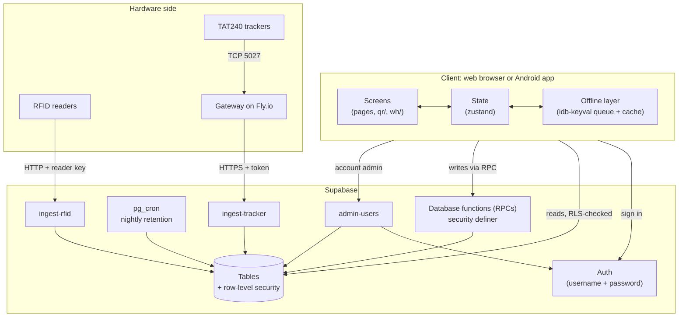

### The three rules the design follows

1. **The database is the boss.** The app can never be trusted to enforce permissions, because anyone can change app code in their browser. So every permission is checked inside the database.
2. **Writes go through checked functions.** For anything that must stay correct (stock, installs, shipments), the app does not edit tables directly. It calls a function that checks the rules and does the change in one step.
3. **Everything can be repeated safely.** Each action carries a unique id. If a phone resends after a bad signal, the database sees the same id and does nothing the second time. This is what makes offline mode safe.

---

## 4. Who can do what

Three levels, then per-feature switches.

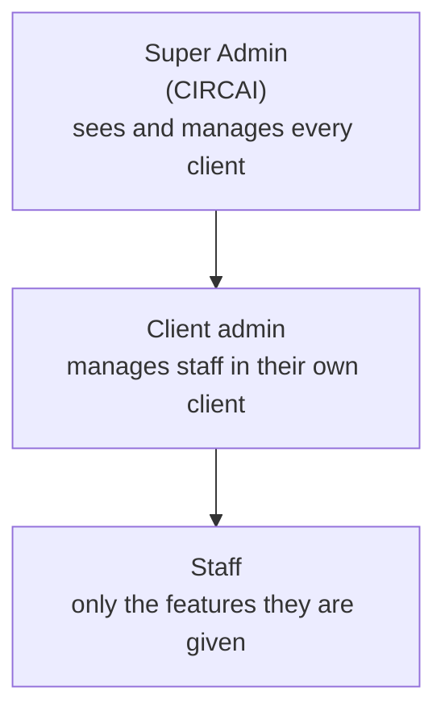

- A client has a list of **features** switched on (`orgs.features`).
- Each person has their own list (`profiles.features`). It can never contain more than the client's list. If a feature is taken away from a client, it is removed from every person in that client automatically.
- Page names double as feature names, so the menu simply hides pages the person lacks (`hasFeature(role, id)`).
- **Account changes only go through `admin-users`.** It runs with a server key, checks the caller's role, and only accepts feature names from a fixed list (unknown ones are silently dropped, so a new feature must be added there).
- Sign-in uses a username. Internally it becomes `username@textrak.local`, so people do not need an email address.

### How a database request is checked

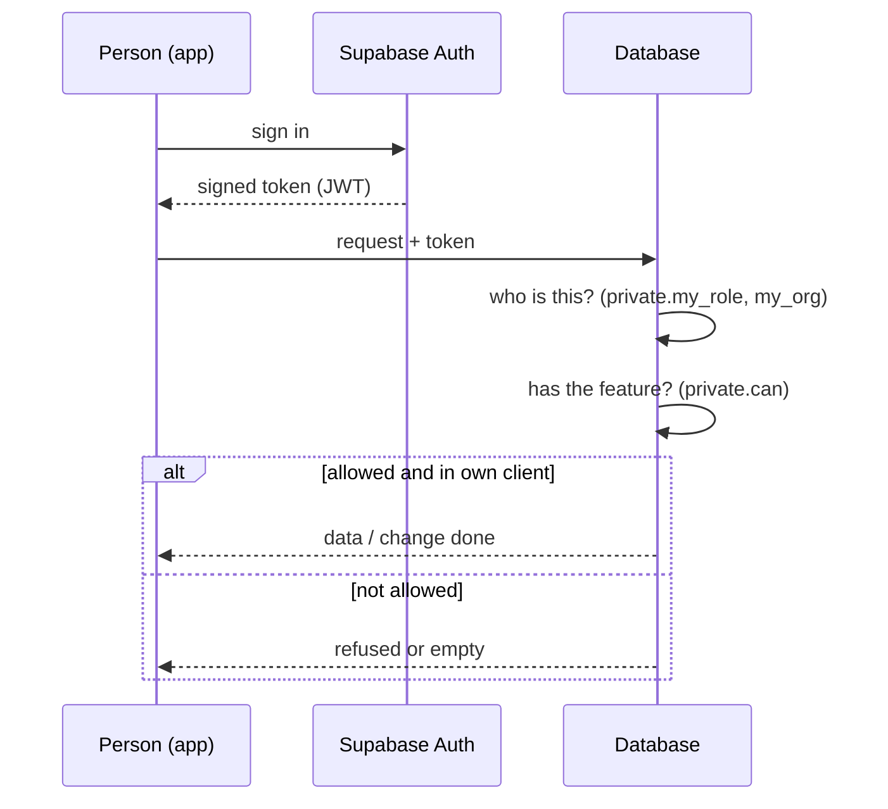

Small helper functions in a private schema (`my_role()`, `my_org()`, `can(feature)`) are used by every table's rules. Rules read the person from the token, never from anything the app sends.

---

## 5. The data

Grouped by area. All tables carry the client (`org_id`) so each client only ever sees its own rows.

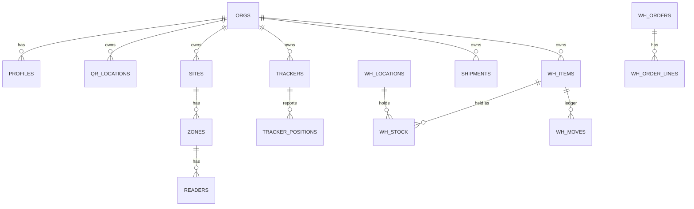

(Simplified. Table names above are for orientation; the exact names are in the database.)

| Area | What is stored |
|---|---|
| Accounts | Clients (`orgs`), people (`profiles`) |
| Curtains (QR) | Locations, label codes, installs and take-downs, scan log |
| RFID | Sites, zones, readers (with their own keys), tagged items, reads |
| Tracking | Trackers, vehicles, positions of trackers and phones |
| Shipments | Bookings and their step history |
| Warehouse (`wh_`) | Items, codes, locations, partners, stock, receipts, orders, ledger (`wh_moves`), counts, counters, idempotency record (`wh_ops`) |

---

## 6. How each part works

### 6.1 Curtains (QR), the Synergy use-case

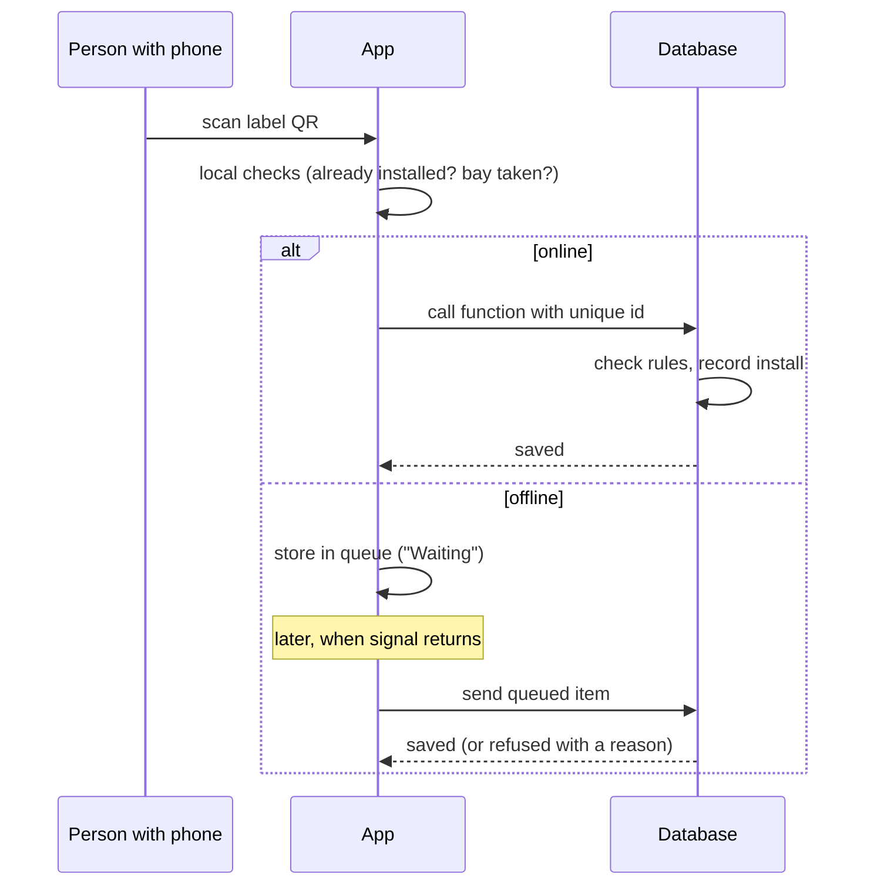

- **Labels** are generated in bulk (up to 50,000), numbered so a code is never reused.
- A label goes through states: registered → installed → taken down → retired (or swapped).
- The database refuses: a bay that already has a curtain, a label already installed, a label from another client, or staff without the feature.
- Every scan appears in the log as **Saved**, **Waiting** or **Not saved**.

### 6.2 Laundry and linen (RFID)

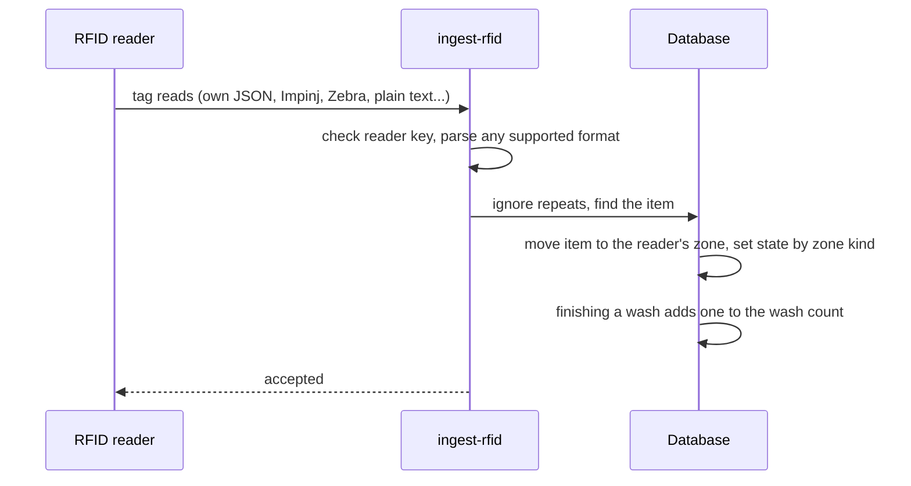

- Each reader has its **own address and key**, so one leaked key affects one reader. Keys are hidden from everyone except the Super Admin.
- The function understands many reader formats and time units (seconds, milliseconds, microseconds).
- The same tag read twice quickly is stored once. An unknown tag is logged once, not repeatedly.
- A missing item that is later seen is marked found.

### 6.3 Vehicle trackers (Teltonika TAT240)

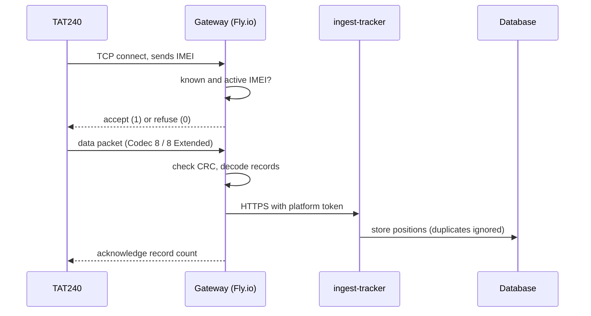

- The tracker is set to send every **360 seconds**.
- The gateway decodes the binary packet, checks its CRC, and acknowledges records in order. Without the acknowledgement the tracker would keep resending.
- A reading with no GPS fix (0,0) is ignored on the map and the UI shows "waiting for GPS".
- A reading sent twice is stored once (unique on device and time).

### 6.4 Phones and browsers as trackers

- The signed-in person's phone becomes a device named after them. Another user cannot report for it.
- Android uses a **foreground service** (with a notification) so tracking continues with the screen off. How reliable this is depends on the phone's battery settings.
- Positions taken offline are kept on the phone and sent later.
- A browser can track only while its page is open.

### 6.5 Route history and the 30-day rule

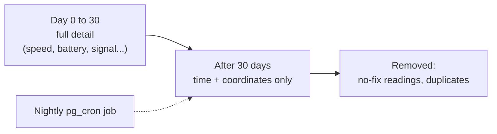

Route history is available by day for 30 days, with distance, moving time and CSV download. The nightly job trims older rows to coordinates only so the table stays small.

### 6.6 Shipments

A shipment moves through fixed steps: **booked → dispatched → in transit → received**, with a **problem → resolved** branch. The database refuses steps out of order and shipments from other clients. Dispatch and receive can be done by scanning.

### 6.7 Warehouse (generic QR / barcode / RFID stock)

A separate module (`wh_` tables, 15 screens) for any client's stock. It is separate from Curtains, which is specific to Synergy.

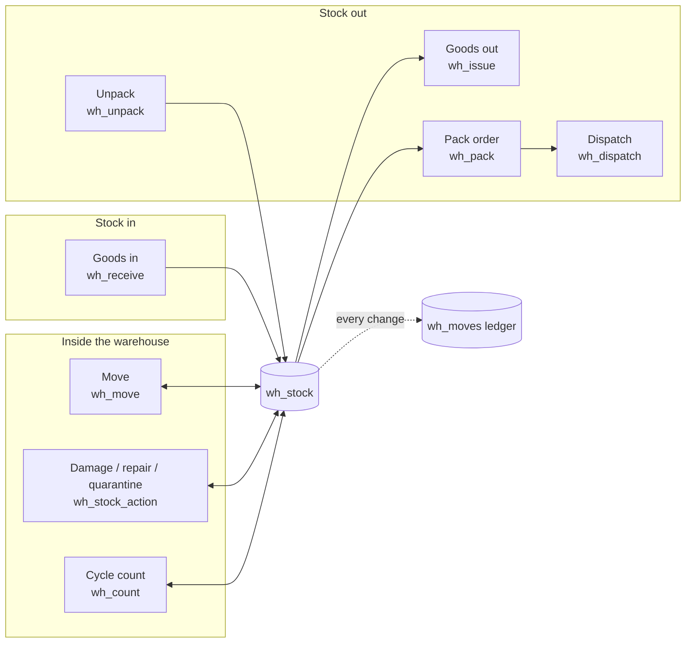

**Stock is held by:** client + item + location + lot + status. Statuses are `available`, `quarantine`, `repair`, `scrap`.

**How a pick works (`wh_pick`):** soonest expiry first (FEFO), then oldest. **Expired stock is never picked. Only `available` stock is picked.** If there is not enough, the whole action is refused, so no half-picks.

**Every change** writes a row to the ledger (`wh_moves`). The ledger is the audit trail: stock can be explained from it.

**Safety:** items, codes and partners need the `whitems` feature; locations need `whlocations`. Stock, orders and the ledger can be written **only** by the functions above. Each takes `p_op` (the unique id) so a repeat does nothing. Reasons are required for write-offs and adjustments.

**Scanning one box for everything.** `resolveCode` works out what a scanned code is: our own labels (`WH:I:` item, `WH:L:` location, `WH:O:` order), an alias code, a barcode (with or without leading zeros), or an order number (`PK-`, `GI-`, `GO-`). The Smart scan screen uses this to offer the right next action.

**Insights (`wh_insights`)** is one database call that returns: summary, reorder suggestions, ABC classification, expiry risk, dead stock, space use, count variance, anomalies, stuck orders, old orders and which items to count next. The dashboard turns this into a ranked to-do list with reasons.

### 6.8 Working offline (Warehouse)

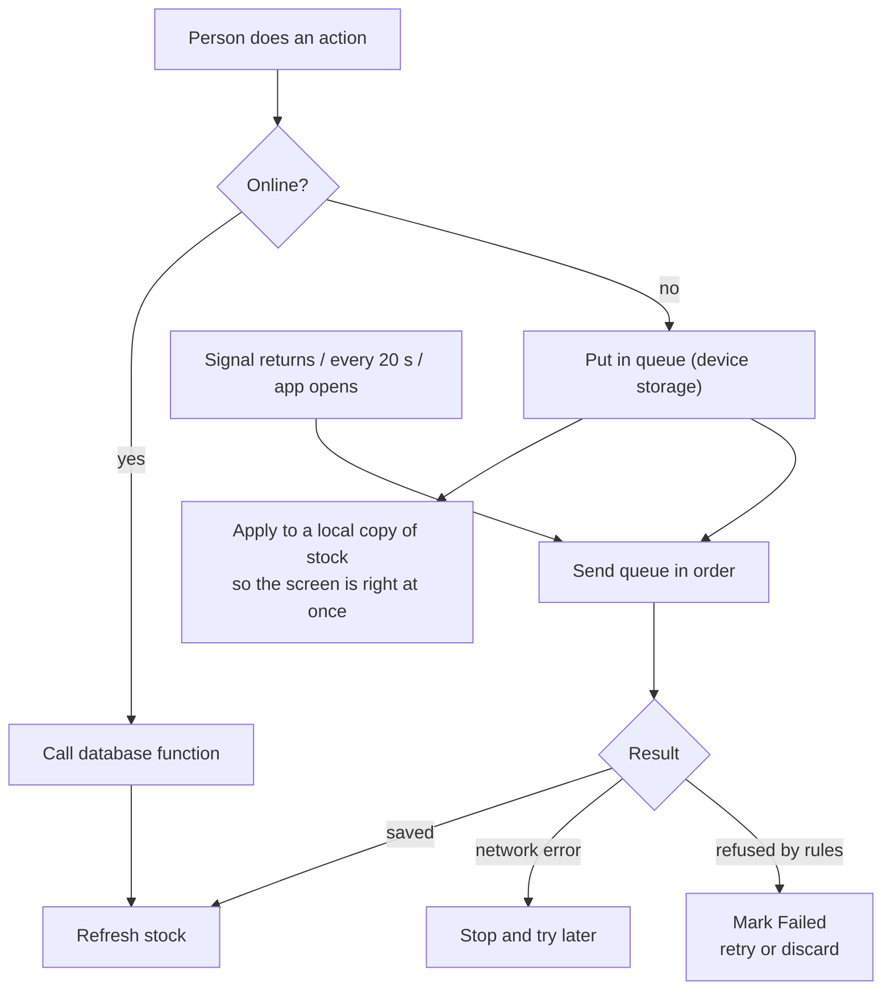

- The app keeps a **base** copy of the last stock it loaded and a list of waiting operations. What you see is the base with those operations applied on top (`overlay`).
- Operations are sent **one at a time, in order**. A network error pauses the queue. A rule refusal marks only that operation as failed.
- **Works offline:** goods in, goods out, pack, move, damage/repair, count. Stock and insights are cached on the device.
- **Needs a connection:** dispatch, unpack, orders, ledger, imports, and edits to items and locations. These change several records or need the latest truth, so they are not queued.
- Curtains (QR) has its own, similar queue.

---

## 7. Live data and Demo data

The app has two modes. **Live** reads real data from the database. **Demo** uses built-in sample data so the product can be shown without real customers. Pages that only have demo data (Intelligence, Daily flow, Community assets, Recycling proof, Impact) are hidden in Live mode, so nobody mistakes sample numbers for real ones. Device health (online / quiet / offline) is worked out in one place, `app/src/lib/status.ts`.

---

## 8. Code layout

```
Tex-Trak/
├─ app/                       The web + Android app
│  ├─ src/
│  │  ├─ App.tsx              Routes: which page shows for which id
│  │  ├─ store.ts             Shared state (zustand)
│  │  ├─ sim/features.ts      Modules, feature ids, role presets
│  │  ├─ components/Layout.tsx  Sidebar and menu
│  │  ├─ pages/               Map, devices, shipments, admin, help...
│  │  ├─ qr/                  Curtains (QR) screens + offline queue
│  │  ├─ wh/                  Warehouse: store, ui, intel, 15 screens
│  │  ├─ lib/                 supabase, auth, offline, pin, status, geo
│  │  └─ native/              Phone-only code (location, camera)
│  └─ android/                Capacitor Android project
├─ gateway/                   TCP gateway for trackers (Fly.io)
├─ supabase/functions/        admin-users, ingest-rfid, ingest-tracker
└─ docs/                      This guide, product guide, training, feature plan
```

Where to look when changing something:

| To change… | Edit |
|---|---|
| Who sees which page | `app/src/sim/features.ts`, then `supabase/functions/admin-users/index.ts` (feature list) and redeploy |
| Add a Warehouse rule | A database migration (functions starting `wh_`), then `app/src/wh/store.ts` |
| Tracker data format | `gateway/src` |
| RFID reader formats | `supabase/functions/ingest-rfid` |
| Online / offline status wording | `app/src/lib/status.ts` |

---

## 9. Security in short

- Passwords are handled by Supabase Auth; the app never stores them. A quick **PIN** on the phone is stored only as a hash.
- Every table has row-level security. A client can only reach its own rows, and only if the feature is switched on for them.
- Stock, installs and shipments change only through functions that check rules; direct writes are not allowed.
- Hardware keys: each RFID reader has its own key; the tracker path uses a platform token; trackers must be registered and active by IMEI.
- Account creation exists only in `admin-users`, which checks the caller's role on every request. First-time setup of the first Super Admin needs a secret setup token and works only while no Super Admin exists.
- Function execute rights are removed from the public and anonymous roles; only signed-in users can call them.
- The Supabase security advisor shows only expected notes. **Still to switch on by the owner:** leaked-password protection and daily backups.

---

## 10. Building and deploying

| Part | How |
|---|---|
| Web app | `cd app && npm install && npm run build` (output in `app/dist`) |
| Android | Build the web app, sync Capacitor, then build the signed app in Android Studio |
| Database | Apply migrations in Supabase (the Warehouse migration was applied directly and has no file in the repo yet) |
| Edge functions | Deploy from Supabase (`admin-users` is on v5, without JWT verification at the platform edge because the function checks the token itself) |
| Gateway | `cd gateway && fly deploy` (a redeploy is pending for the latest hardening) |

---

## 11. Limits worth knowing

- Background phone tracking may stop if Android closes the app; it resumes when the app is opened.
- Offline mode does not cover label generation, imports, account management, or Warehouse unpack and dispatch.
- RFID readers must be able to send HTTP. Readers that only speak MQTT or raw TCP need a small bridge.
- The new screens, camera and handheld scanning, printing, the Android app on a real phone and a real RFID reader have not yet been tested on real equipment. See `FEATURE_PLAN.md`.
- The Warehouse migration is not stored as a file in the repository; exporting it is a sensible next step so the database can be rebuilt from code.
